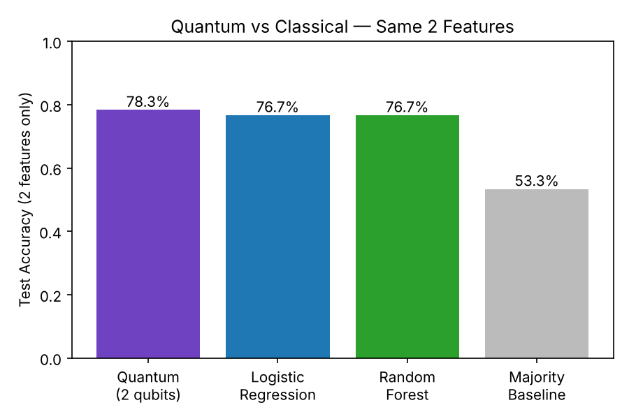
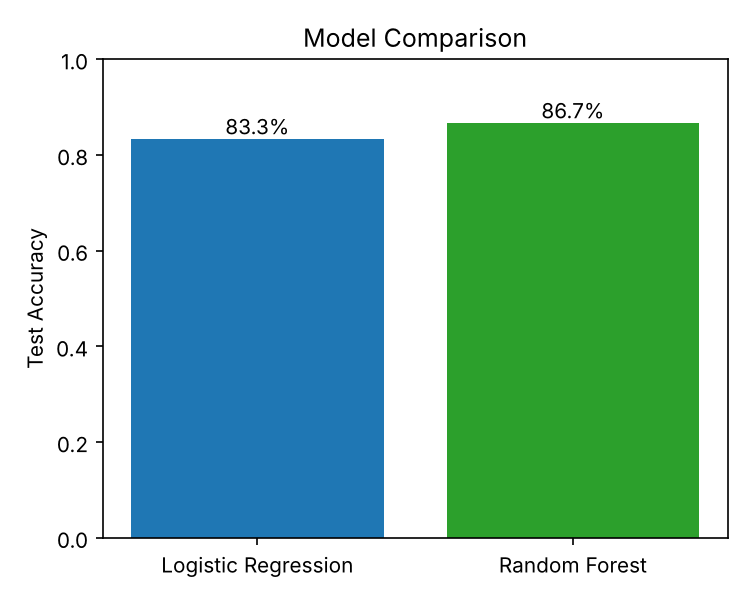
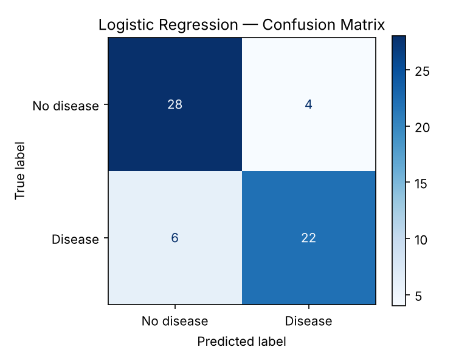
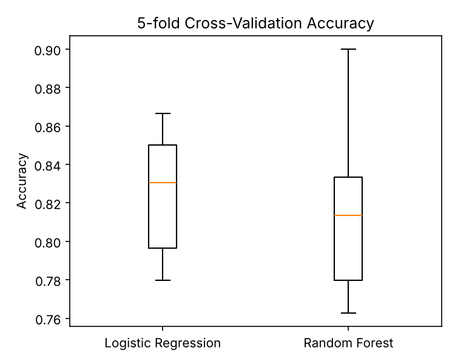
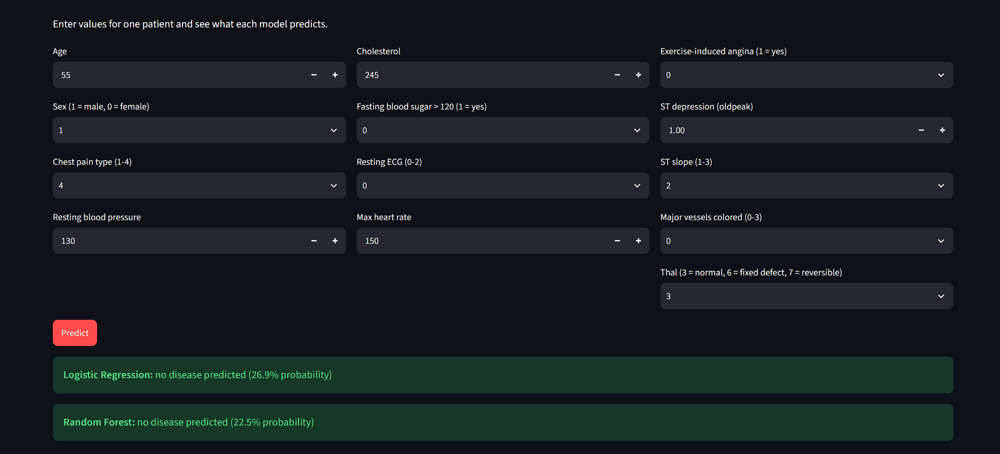

<h1 align="center"> Heart Disease Prediction</h1>

<p align="center">
  <b>A classical machine-learning baseline: Logistic Regression vs Random Forest, with a local web app to try it out and a small quantum classifier for comparison.</b>
</p>

<p align="center">
  
  
  
  
</p>

> **Please note:** this is a learning and research project built on a small public dataset.
> It is **not medical advice** and must never be used to diagnose or treat anyone.

---

##  What this project does

Given a patient's clinical measurements (age, cholesterol, blood pressure, maximum heart rate and so on), the project predicts whether the patient is likely to have heart disease.

I built it in four stages:

1. **A notebook** that loads the data, cleans it, trains two models and evaluates them carefully.
2. **A saved model file** (`heart_models.joblib`) produced by the notebook.
3. **A local web app** (`HRTGUI.py`) where I can compare the models, test random patients, type in a new patient, or upload a CSV of many patients.
4. **A quantum comparison** (Qiskit, run on a simulator) that uses just 2 features and is compared with the classical models on the same 2 features.

The goal was a solid, honest classical baseline first, and only then the quantum extension.

---

##  Results at a glance

| Model | Test accuracy | 5-fold CV accuracy | ROC AUC |
|---|---|---|---|
| Logistic Regression | **83.3%** | 82.5% (± 0.032) | 0.950 |
| Random Forest | **86.7%** | 81.8% (± 0.048) | 0.946 |

**The honest takeaway:** Random Forest looks better on the single 80/20 split, but cross-validation shows the two models perform almost the same (a gap of 0.007, much smaller than the fold-to-fold spread). With only 297 patients, there is no clear winner.

I also built a small 2-qubit quantum classifier. On just two features it reached **78.3%**, about the same as the classical models on those same two features (76.7%). See the quantum section below.

---

##  Project structure

```
heart_project/
├── heart_disease_prediction_local.ipynb   # data cleaning, training, evaluation
├── HRTGUI.py                              # Streamlit web app
├── processed.cleveland.data               # the dataset (Cleveland subset)
├── heart_models.joblib                    # trained models (created by the notebook)
├── images/                                # screenshots used in this README
└── ProjectDescription.md
```

---

##  The data

- **Source:** UCI Machine Learning Repository, *Heart Disease* dataset (donated 1988). It combines four hospital databases; this project uses only the **Cleveland** file, `processed.cleveland.data`.
- **Size:** 303 patients and 14 columns. Six rows had missing values (written as `?` in columns `ca` and `thal`), so after cleaning **297 patients** remain.
- **Target:** the original label runs from 0 (no disease) to 4 (severe). I turned it into a yes/no label: **0 = no disease, 1 = disease**. This gives 160 patients without disease and 137 with disease, so the classes are fairly balanced.

| Column | Meaning |
|---|---|
| `age` | Age in years |
| `sex` | 1 = male, 0 = female |
| `cp` | Chest pain type (1 to 4) |
| `trestbps` | Resting blood pressure |
| `chol` | Serum cholesterol |
| `fbs` | Fasting blood sugar above 120 (1 = yes) |
| `restecg` | Resting ECG result (0 to 2) |
| `thalach` | Maximum heart rate achieved |
| `exang` | Exercise-induced angina (1 = yes) |
| `oldpeak` | ST depression during exercise |
| `slope` | Slope of the peak exercise ST segment (1 to 3) |
| `ca` | Number of major vessels coloured by fluoroscopy (0 to 3) |
| `thal` | Thallium test result (3 = normal, 6 = fixed defect, 7 = reversible defect) |
| `target` | Heart disease present (1) or not (0) |

---

##  How it works

1. **Load and inspect** the data with pandas (`head`, `shape`, missing-value counts).
2. **Clean:** replace `?` with missing values, drop those rows, convert everything to numbers, and make the target binary.
3. **Split** into 80% training and 20% test with a fixed `random_state=42` and stratification, so results are repeatable and both sets keep the same class balance.
4. **Scale** the features with `StandardScaler`, fitted on the training data only, so no information leaks from the test set.
5. **Train two models:** Logistic Regression (the baseline) and a Random Forest with 200 trees.
6. **Evaluate** with accuracy, precision, recall, F1, ROC AUC and a confusion matrix.
7. **Cross-validate** with 5 folds. The scaler sits inside a pipeline so it is re-fitted inside every fold. This gives more reliable numbers than a single split.
8. **Stress-test:** repeat the split 20 times with different random seeds, and check predictions on random unseen patients.
9. **Save** the trained models with joblib so the web app can use them.
10. **Quantum extension:** pick the 2 best features, encode them into a 2-qubit circuit, train 6 rotation weights with COBYLA on a simulator, and compare with the classical models on the same 2 features.

---

##  Detailed results

### Test set (60 unseen patients)

| Model | Accuracy | Precision | Recall | F1 | ROC AUC |
|---|---|---|---|---|---|
| Logistic Regression | 0.833 | 0.846 | 0.786 | 0.815 | 0.950 |
| Random Forest | 0.867 | 0.885 | 0.821 | 0.852 | 0.946 |

### Confusion matrix (Logistic Regression)

|  | Predicted: no disease | Predicted: disease |
|---|---|---|
| **Actually no disease** | 28 (true negatives) | 4 (false positives) |
| **Actually disease** | 6 (false negatives) | 22 (true positives) |

50 of 60 patients were classified correctly. The 4 false positives are healthy people flagged by mistake. The **6 false negatives** are sick patients the model missed, which is the more serious error in a medical setting. Recall for the disease class is 0.79, so about 1 in 5 sick patients is missed.

### 5-fold cross-validation

| Model | Mean accuracy | Std | Folds |
|---|---|---|---|
| Logistic Regression | 0.825 | 0.032 | 0.850, 0.867, 0.780, 0.831, 0.797 |
| Random Forest | 0.818 | 0.048 | 0.833, 0.900, 0.780, 0.763, 0.814 |

The boxes overlap heavily, so the two models are statistically hard to tell apart. Logistic Regression was a little steadier from fold to fold.

### Stability across 20 random splits (Logistic Regression)

Mean accuracy **0.843**, standard deviation 0.033, lowest 0.783, highest 0.917. With a test set of only 60 patients, a single accuracy number can swing by more than ten points depending on the split, which is why I rely on cross-validation.

### Example prediction in the web app

I entered one sample patient in the **Enter a patient** tab (age 55, male, chest pain type 4, blood pressure 130, cholesterol 245, fasting sugar 0, ECG 0, max heart rate 150, no angina, ST depression 1.0, slope 2, 0 vessels, thal 3):

| Model | Prediction | Probability of disease |
|---|---|---|
| Logistic Regression | No disease predicted | 26.9% |
| Random Forest | No disease predicted | 22.5% |

Both models agree that this patient is more likely healthy than not.

---

##  Quantum comparison 

After the classical baseline worked, I added a small **variational quantum classifier**. It runs on a **simulator** on my own computer (not on real quantum hardware) and uses only **2 features**, one per qubit.

**How it works**

1. **Choosing the features:** I tested every pair of features with a simple classical model using 5-fold cross-validation on the *training data only*, and kept the best pair: `oldpeak` and `thal`.
2. **Encoding:** both values are scaled to angles between 0 and pi and written into a 2-qubit circuit with a ZZ-style feature map (repeated twice).
3. **Trainable layer:** 6 adjustable rotation angles (the "weights") with entangling gates. The classical optimiser COBYLA (from SciPy) tunes them by minimising cross-entropy loss, using 120 steps on a balanced subset of 120 training patients.
4. **Prediction:** measure both qubits. An odd result (`01` or `10`) means *disease*; an even result (`00` or `11`) means *no disease*.

**Results on the same 60 test patients, using the same two features**

| Model (2 features only) | Test accuracy |
|---|---|
| Quantum (2 qubits, simulated) | **78.3%** |
| Logistic Regression | 76.7% |
| Random Forest | 76.7% |
| Always guess the majority class | 53.3% |



**Example prediction:** for a patient with `oldpeak = 2.5` and `thal = 7` (a reversible defect), the quantum model gave an **89.2% probability of disease**, so it predicted disease. For comparison, a patient with `oldpeak = 1.0` and `thal = 3` (normal) got 26.9%.

**The honest takeaway:** the quantum model learns something real and moves in the right direction, but its lead over the classical models is just one patient out of 60, which is not a meaningful difference. It is also well below the classical models that use all 13 features (83 to 87%), because two features carry far less information. There is **no quantum advantage** here, and because it is a simulation of a tiny circuit, this is a learning exercise rather than a performance claim.

---

##  The web app

Run it locally and it opens in the browser at `http://localhost:8501`. It has four tabs:

| Tab | What it does |
|---|---|
| **Model comparison** | Metrics table, bar chart, ROC curves, confusion matrices, cross-validation boxplot and Random Forest feature importance |
| **Random test patients** | Draws random patients from the unseen test set and shows the real answer next to each model's prediction |
| **Enter a patient** | Type in one patient's 13 values and see each model's prediction and probability |
| **Upload a CSV** | Upload a file of many patients and get predictions for all of them, plus accuracy if the file has a `target` column |

<!-- Add your own screenshots to the images/ folder, then keep or edit these lines -->





---

##  Tools and libraries used

### Tools

| Tool | Used for |
|---|---|
| [Python 3.12](https://www.python.org/) | The programming language |
| [Antigravity IDE](https://antigravity.google/) | Editing and running the notebook and app |
| [Jupyter Notebook](https://jupyter.org/) (`.ipynb`) | Step-by-step analysis with saved outputs |
| [Google Colab](https://colab.research.google.com/) | Tried first; it can run the notebook if you prefer a cloud option |
| [GitHub](https://github.com/) | Hosting and submitting the project |

### Python libraries

| Library | What I used it for |
|---|---|
| [pandas](https://pandas.pydata.org/) | Loading the CSV, cleaning and tables |
| [NumPy](https://numpy.org/) | Numerical arrays and calculations |
| [scikit-learn](https://scikit-learn.org/) | Train/test split, scaling, both models, pipelines, cross-validation and all metrics |
| [matplotlib](https://matplotlib.org/) | Confusion matrix, boxplot, ROC curves and bar charts |
| [joblib](https://joblib.readthedocs.io/) | Saving and loading the trained models |
| [Streamlit](https://streamlit.io/) | The local web app |
| [ipykernel](https://pypi.org/project/ipykernel/) | Lets the IDE run notebook cells |
| [Qiskit](https://qiskit.org/) | Building and simulating the 2-qubit quantum circuit |
| [SciPy](https://scipy.org/) | The COBYLA optimiser that trains the quantum circuit |

Install everything with one command:

```bash
pip install pandas numpy scikit-learn matplotlib joblib streamlit ipykernel scipy qiskit
```

---

##  How to build and run it yourself

1. **Get the data.** Download it from the [UCI Heart Disease page](https://archive.ics.uci.edu/dataset/45/heart+disease) (the Download button gives a zip). Unzip it and keep only `processed.cleveland.data`.
2. **Create a project folder**, for example `heart_project`, and put the data file in it.
3. **Install the libraries** with the `pip install` command above.
4. **Open the folder** in your IDE (I used Antigravity) and open the notebook.
5. **Select the Python kernel** (top right of the notebook) and click **Run All**.
   - Check that `df.shape` shows `(303, 14)`, then `(297, 14)` after cleaning.
   - The model-saving cell prints `Saved heart_models.joblib`.
   - The quantum section starts with `%pip install qiskit` (about 1 to 3 minutes the first time). If the next cell cannot find Qiskit, restart the kernel and run again. Training the quantum model takes roughly a minute.
6. **Start the web app** from a terminal opened in the project folder:
   ```bash
   python -m streamlit run HRTGUI.py
   ```
7. **Open** `http://localhost:8501` if the browser does not open by itself. Press `Ctrl+C` in the terminal to stop the app.

### Where the outputs come from

| Output | How to get it |
|---|---|
| Accuracy, confusion matrix, classification report, cross-validation scores | Run the notebook cells; the results are saved inside the `.ipynb` |
| Charts (confusion matrix, boxplot) | Appear under the notebook cells; take a screenshot or right-click to save |
| Trained models | `heart_models.joblib`, created by the last notebook cell |
| Live predictions and comparison charts | The web app at `localhost:8501` |
| Batch predictions | The **Upload a CSV** tab (needs a header row with the 13 feature columns) |
| Quantum results | The quantum cells at the end of the notebook: training progress, the quantum vs classical bar chart, and a single-patient prediction |

---

##  Problems I ran into (and the fixes)

| Problem | Cause | Fix |
|---|---|---|
| Colab said *"Failed to assign a backend"* | Free Colab capacity or quota limits | Moved to running locally in the IDE |
| IDE showed a *"Python Environment Tools failed"* message | A hiccup in the Python extension | Reloaded the window and selected the kernel again |
| Notebook cell 1 failed | Packages were missing in the notebook's Python | Installed them with `%pip install ...` and restarted the kernel |
| App crashed loading `heart_models.joblib` | The notebook ran on Python 3.12 but `python` in the terminal was 3.10, so pandas versions differed | The app now falls back to training fresh if the saved file cannot be loaded; running both in the same Python also avoids it |

---

##  Limitations

- **Small data:** only 297 patients after cleaning, so every number carries real uncertainty.
- **One source:** all patients come from a single hospital (Cleveland), so the models may not carry over to other populations.
- **Missed cases:** about 1 in 5 patients with disease is missed by the baseline model.
- **Quantum part is a toy:** it is a simulation with only 2 features and 2 qubits, so it says nothing about real quantum advantage.
- **Not clinical software:** no medical validation was done, and the results must not be used for real decisions.

##  Possible next steps

- Tune the models (for example `GridSearchCV`) and try other algorithms.
- Add the other three hospital datasets for a larger, more varied sample.
- Optimise for recall so fewer sick patients are missed.
- Try the quantum model with more features and qubits, other feature maps, or real quantum hardware.

---

##  Links and references

- Dataset page: <https://archive.ics.uci.edu/dataset/45/heart+disease>
- Direct data file: <https://archive.ics.uci.edu/ml/machine-learning-databases/heart-disease/processed.cleveland.data>
- Dataset creators: Andras Janosi, William Steinbrunn, Matthias Pfisterer, Robert Detrano
- scikit-learn documentation: <https://scikit-learn.org/stable/>
- Streamlit documentation: <https://docs.streamlit.io/>
- pandas documentation: <https://pandas.pydata.org/docs/>
- Google Colab: <https://colab.research.google.com/>
- Qiskit (used for the quantum section): <https://qiskit.org/>
- SciPy documentation: <https://docs.scipy.org/doc/scipy/>

---

##  AI assistance

I used an AI assistant as a learning aid and coding helper in debugging for unsolved Errors. It explained concepts that were new to me, such as Random Forests, ROC curves, cross-validation and confusion matrices, and it helped draft and debug the notebook (including the quantum section) and the web app.

The hands-on work was mine: I chose the project, set up my own environment, ran every step, fixed the setup problems that came up (Colab, kernel and Python version errors), tested predictions on different patients, and worked through the results until I understood them.

---

<p align="center"><sub>Learning project · Not medical advice · Built by <b>Dev Kr Lahkar</b></sub></p>
